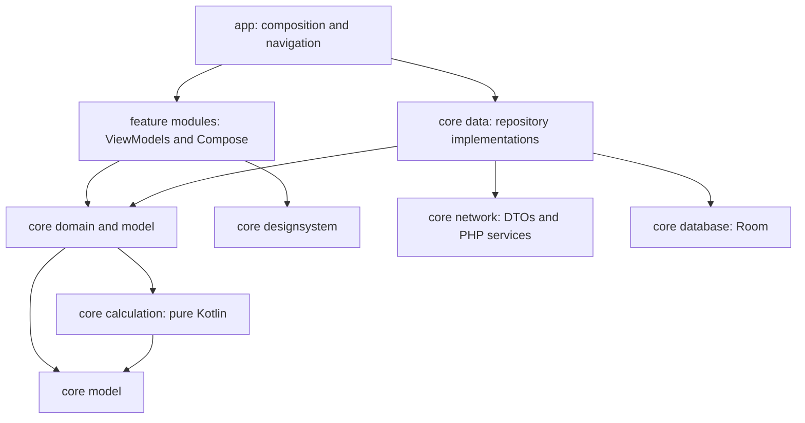

# Android architecture and project structure

Status: Phase 1 implementation, informed by observed website contracts. A Gradle project exists under `android/`; its JVM checks and debug assembly pass locally ([evidence](phase-1-status.md)), while device tests and CI remain unverified. Package `ir.mabhas19.android` and minSdk 26 are provisional owner decisions; verify name ownership/device audience before release. The pinned JDK/Gradle/AGP/Kotlin/Compose/SDK set was selected for compatibility, not recency.

## Stack decisions

| Concern | Proposed implementation | Reason |
|---|---|---|
| UI | Kotlin, single Activity, Compose and Material 3 | Native forms, accessible RTL, adaptive lists/detail editors |
| State/navigation | ViewModel + StateFlow, lifecycle collection, Navigation 3 with typed destinations | Explicit project identity, restorable navigation and testable UI state |
| Domain | Pure Kotlin model, calculation and use-case modules | Deterministic engineering logic without Android dependencies |
| Networking | Retrofit + OkHttp + kotlinx.serialization | Typed PHP contracts, injectable service/cookie handling and MockWebServer tests |
| Local data | Room, transactions and versioned schemas | Durable structured drafts, references, revisions and pending writes |
| Preferences | DataStore | Theme, locale/display preferences and non-sensitive settings |
| Dependency injection | Hilt, constructor injection | Shared repositories/session scope and WorkManager integration |
| Background sync | WorkManager after auth/idempotency contract is verified | Retry scheduling survives app restarts; conflicts remain explicit |
| Export | Storage Access Framework, Android print/PDF/share integrations | User-selected JSON/report files and clear export destination |
| Tests | JUnit, coroutine test utilities, fakes, MockWebServer, Room instrumentation, Compose UI tests | Fast rule/state tests plus targeted device integration |
| Quality/build | Gradle Kotlin DSL, version catalogue, convention plugins, ktlint/Detekt, Android Lint | Consistent reproducible module policy |

Dependencies and exact tool versions must be checked against official compatibility/release docs during scaffolding. Prefer a small number of purposeful modules; do not create one module per form just to match the tree.

## Dependency direction



Features depend on repository/use-case interfaces; app wires their implementations. Features do not call Retrofit/Room directly or depend on sibling feature internals. Domain defines interfaces/use cases; data implements them. Shared model and calculation modules have no Android SDK imports. The database is the UI's durable source of drafts, not the source of regulatory truth.

## Intended repository layout

```text
Mabhas19/
├── AGENTS.md
├── README.md
├── .agents/skills/reverse-engineer-anything/  # installed official REA skill
├── docs/
│   ├── discovery/                          # extracted facts and sources
│   ├── android/                            # architecture, roadmap, tests
│   └── open-questions.md
├── research/
│   ├── README.md
│   ├── evidence/                           # reviewed public provenance/fixture/screenshots
│   └── local/                              # ignored raw captures and browser profiles
├── tools/research/                         # bounded collection and REA automation
└── android/                                # Android Studio/Gradle root (Phase 1)
    ├── README.md
    ├── settings.gradle.kts
    ├── build.gradle.kts
    ├── gradle.properties
    ├── gradle/libs.versions.toml
    ├── gradle/wrapper/{gradle-wrapper.jar,gradle-wrapper.properties}
    ├── gradlew / gradlew.bat
    ├── build-logic/                         # convention plugins
    ├── app/
    │   └── src/{main,test,androidTest}/
    ├── core/
    │   ├── model/                          # IDs, units, edition, typed states
    │   ├── domain/                         # repository contracts/use cases
    │   ├── calculation/                    # independently verified rule implementations
    │   ├── network/                        # API DTOs, auth, error mapping
    │   ├── database/                       # entities, DAOs, schema migrations
    │   ├── data/                           # repositories, DTO/entity mappers, sync
    │   ├── designsystem/                   # Persian theme and reusable controls
    │   └── testing/                        # test-only fakes/fixtures/dispatchers
    ├── feature/
    │   ├── projects/                       # profile/context/classification
    │   ├── envelope/                       # walls, roof/floor, material assemblies
    │   ├── openings/                       # glazing and shading
    │   ├── controls/                       # daylight, boundaries, bridges, air sealing
    │   ├── airtightness/                   # measured test; first vertical slice
    │   ├── checklists/                     # all discipline projections/chapter controls
    │   ├── reports/                        # dossier, JSON/PDF and reviewer views
    │   └── account/                        # session, team, invitations
    └── benchmark/                          # introduced at performance phase
```

The Phase 1 modules (`app`, `core/*`, `feature/projects`) exist and build; later feature modules are added as phases require them, with working builds and tests. The tree is a target, not a statement that every file exists. Keep `.github/workflows/` at repository root even though Gradle lives in `android/`.

Within a feature: `src/main/kotlin/.../<feature>/{navigation,ui,presentation}`, `src/test/kotlin/...`, and `src/androidTest/kotlin/...` for meaningful device UI tests. ViewModels expose immutable UiState and accept user actions. Side effects update durable state and then UI state; avoid unconsumed one-shot event channels for critical save results.

## Calculation and data boundaries

- Model an edition as a type, not a free string throughout the app. Use API mappers for `1399-v4` versus `M19-1399-4`.
- Use value types/validated quantities for AreaM2, LengthM, ThicknessCm, Conductivity, Resistance and FlowM3PerHour. Keep unknown separate from zero; record calculation precision/rounding policy.
- `CalculationAssessment` separates numeric checks, applicability, missing evidence, review status and whole-building approval flags. Never infer approval from a green numeric check.
- Each result retains input fingerprint, rule/reference versions and server/local origin. Dependency changes make it stale.
- For unverified rules, provide an online service adapter. Offline draft editing is supported; offline numeric evaluation is enabled only for individually verified rule families.
- DTO contracts can differ by endpoint. Capture unknown additions safely while failing clearly for missing required result fields; do not fabricate default numeric answers.

## Auth and sync boundaries

Support guest-only mode immediately. Define a SessionProvider interface; implement member auth only after a supported bootstrap is known. A Custom Tab can host login if the backend offers a verified handoff, but its cookies are not automatically an OkHttp session. Do not implement password scraping or copy browser cookies into committed settings.

Keep sensitive session material in an Android Keystore-backed storage design with a documented backup policy. Use TLS and never disable certificate validation; no speculative certificate pinning. Redact logs, file backups and crash reports. Scope cache/pending writes to account/project/edition and cancel/rebind them on account changes.

Sync is section-aware and uses acknowledged locks. Shared air/checklist aggregate sections have field ownership and merges. User edits while upload is in progress remain dirty. WorkManager never resolves conflicts by changing expected lock to the latest remote version. See [data-and-rules](../discovery/data-and-rules.md).

## Reports

Build a ReportModel from an immutable multi-section snapshot, then render it for screen/JSON/PDF. Show missing/stale/unsupported sections, provenance and preliminary state. Investigate server-generated report parity before selecting the PDF rendering implementation; Persian text shaping and A4 pagination need device/visual verification. Avoid handing arbitrary untrusted HTML to an unrestricted WebView.

## Reference guidance

The stack follows Android's guidance on state-driven UI, repositories, Flow and testable layers: [architecture recommendations](https://developer.android.com/topic/architecture/recommendations), [offline data layer](https://developer.android.com/topic/architecture/data-layer/offline-first), [modularization](https://developer.android.com/topic/modularization), and [testing strategy](https://developer.android.com/training/testing/fundamentals/strategies). These guide the proposed app architecture; they do not establish website behavior.
