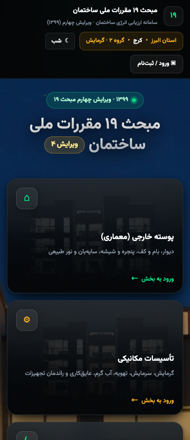
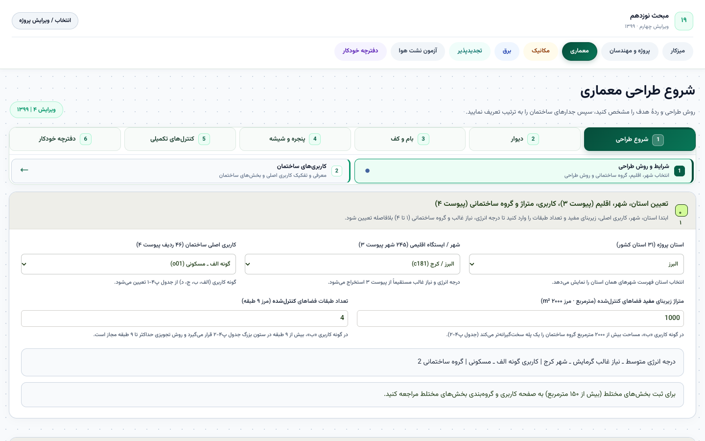

# Design extraction and Android adaptation

Observed via served CSS/HTML and REA screenshots on 2026-10-27. Values below describe web assets; Android dimensions and components are proposed adaptations.

## Visual evidence

The mobile home is dark by default, with a building-image background, large rounded discipline cards, emerald/amber accents, climate chip and account/theme controls. The engineering workspace is light with green active steps, restrained panels, dense forms, an edition badge and six-step architecture navigation. The old shared stylesheet also contains wine/beige tokens that later styles override; copying the first stylesheet alone would misrepresent the current UI.

## Observed tokens

| Role | Served value | Source |
|---|---|---|
| Home dark canvas | `#040507` | `assets/v4-home-motion80.css?v=82` |
| Dark surfaces | `#0d1216`, `#11181d`, `#151e24` | Same |
| Home primary | `#00df81` | Same |
| Home amber | `#f2aa22` | Same |
| Dark text/muted | `#ffffff`, `#94a3b8` | Same |
| Home light canvas/surface | `#f5f7fa`, `#ffffff` | `html[data-theme=light]` declarations |
| Light primary/amber | `#009b60`, `#b96c00` | Same |
| Light text/muted | `#111827`, `#667085` | Same |
| Workspace primary range | `#064e3b`, `#065f46`, `#0f766e`, `#059669` | `assets/v4-v5style-envelope85.css?v=86` |
| Workspace surfaces/borders | `#f8fafc`, `#ecfdf5`, `#e2e8f0`, `#cbd5e1` | Same |
| Legacy shared tokens | canvas `#f2f0eb`, wine `#421d24` | `assets/v4-workspace.css`; overridden in current screens |

The homepage preference key is `m19_theme`; absence selects dark in the observed inline script. Font declarations prefer `Vazirmatn`, then Tahoma/sans-serif. This proves the preferred font family, not that a bundled font/license is available. Obtain approved font files and brand/background assets before shipping.

Shared web declarations include 7–14 px field/card radii, 42 px minimum field heights and 700/800/1100 px responsive breakpoints in different components. The home uses larger cards. Record effective styles per screen rather than treating web pixels as Android dp.

## Proposed native design system

Use Compose Material 3 foundations with an explicit emerald brand scheme, light and dark theme, and discipline accents (architecture green, mechanics amber, electrical blue, renewables teal, dossier purple). Disable automatic dynamic brand recoloring initially so engineering status/discipline semantics stay stable. Verify contrast before finalizing colors.

Define spacing 4/8/12/16/24/32 dp, minimum touch targets 48 dp, rounded cards, compact metadata chips and clearly separate input, derived result, evidence and sync state. On phones replace wide engineering rows with expandable layer/opening cards. On tablets use pane layouts and optional tabular summaries. Keep units visible at entry time.

Reusable components: ProjectContextHeader, EditionBadge, DisciplineCard, EngineeringNumberField, UnitLabel, ReferencePicker, EvidenceField, LayerEditor, RepeatableItemList, CalculationSummary, ReviewStatusChip, SyncStatusBanner and ConflictComparison. Loading/error/empty/incomplete states are part of every component contract.

## Persian, RTL and accessibility

- Persian is the primary UI language. Keep original engineering terms in resources and maintain a glossary; do not translate EC or API enum values.
- Use RTL layout with logical start/end padding/alignment. Isolate Latin IDs, units, formulae and decimal values so `m²·K/W`, `W/(m·K)`, `n50` and EC++ read correctly.
- Normalize Persian and Arabic digits, Arabic decimal separator and accepted grouping characters before validation. Decide and test ambiguous comma input. Keep canonical numeric JSON separate from localized display text.
- Iranian years appear in project design inputs; do not convert every numeric year into a Gregorian date. Preserve server timestamps with a clear timezone/date-display policy.
- Provide full labels and errors, screen-reader descriptions for diagrams, non-color status text/icons, sensible focus and keyboard order, and accessible alternatives for material cross sections.
- Check 200% font scale, TalkBack, dark/light contrast, keyboard/IME, landscape, small phones and tablets. Respect reduced motion; a live building background is optional decoration, not an app dependency.

## Remaining design work

Capture runtime light mode and representative filled/error/empty states for walls, glazing, checklists and dossier; obtain owner approval for one unified native direction. Validate brand/font/image usage rights. Screenshot baselines for the Android UI should be intentional native layouts, not pixel comparisons against the responsive website.
